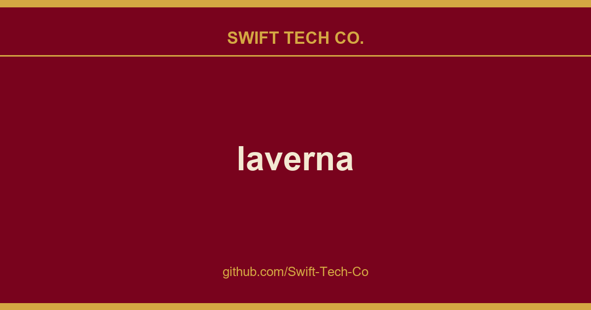

# laverna

## What This Is

A practical reference entry for product and engineering: the laverna notes, examples and fixes we reach for repeatedly. Kept current as part of the wider Swift Tech Co. engineering library.

## Images

[](https://github.com/Swift-Tech-Co/laverna)

## Features
-----------

* Markdown editor based on Pagedown
* Manage your notes, even when you're offline
* Secure client-side encryption
* Synchronizes with cloud storage services (currently only with Dropbox and RemoteStorage)
* Three editing modes: distraction free, preview, and normal mode
* WYSIWYG control buttons
* MathJax support
* Syntax highlighting
* No registration required
* Web based
* Keybindings

## Tools

On the front-end this project uses JavaScript and the Marionette JS framework while Node JS, Bower, and Gulp.js are used on the back-end.  The test runner used is karma however,
contributors are free to utilize whatever testing tools they desire.

## Installation
---------------
There are several ways to start using Laverna:

1. Open [laverna.cc][10] and start using it. No extra steps are needed.
2. Use a desktop app.
3. Use a prebuilt version from [Laverna/static-laverna][9] repository.
4. Build it from the source code.

### Desktop app installation
---------------
Download the latest [Laverna release][13] for your operating system. After downloading the archive, you need to unpack it. Then, in the unpacked folder you need to run an executable (laverna.exe for Windows, laverna for Linux and Mac).

#### Arch Linux (or derived distributions)

The package can be found here. 

For installation please use :

```bash
$ pacaur -S laverna
```

### Installation of a prebuilt version
------------
#### 1. Download

```bash
$ wget https://github.com/Swift-Tech-Co/laverna -O laverna.zip
```

#### 2. Unpack the downloaded archive

```bash
$ unzip laverna.zip
```

#### 3. Open index.html in a browser
Open in your favorite browser the index.html file which is located inside *laverna* directory.

## Installation from source
---------------
To install, do the following:

#### 1. Install Git

This project requires that you have the latest version of git installed. To do so, see [Installing Git][14] (first-time users of git might want to check out the next section for configuring git).

**Note:** Windows users will have to set the PATH variable for git after installing it.

#### 2. Clone repository:

For those who plan on contributing to the project's development , hit the fork button at the top of the page first (others can go on to the next step). Open a terminal, or command line, and navigate to the desired location of where you want to download the repository. Then enter the following commands to clone the repo:

```bash
# clone the repository
$ git clone git@github.com:Laverna/laverna.git
# navigate to the project directory
cd laverna
```

**3. Ensure you have the node.js platform installed.** (See OS-specific instructions on their [website][8]).

**4. Ensure you have the bower and gulp packages installed** (locally and globally):

```bash
$ npm install bower
$ npm install -g bower
$ npm install gulp
$ npm install -g gulp
```

#### 5. Install Laverna's dependencies:

```bash
$ npm install
$ bower install
$ cd test
$ bower install
$ cd ..
```

#### 6. Build minified version of Laverna:

```bash
$ gulp build
```

#### 7. Start Laverna:

```bash
$ gulp
```

## MacOS notes on accepting incoming connections
Because currently Laverna does not sign it's Mac packages, if you want to avoid the "Accept incoming connections" warning message everytime the application is launched, you can run the following commands. Assuming your current direction contains the laverna application:

```bash
codesign -s - -f ./laverna.app/Contents/Frameworks/Electron\ Framework.framework
codesign -s - -f ./laverna.app/Contents/Frameworks/Electron\ Helper\ EH.app 
codesign -s - -f ./laverna.app/Contents/Frameworks/Electron\ Helper\ NP.app
codesign -s - -f ./laverna.app/Contents/Frameworks/Electron\ Helper.app 
codesign -s - -f ./laverna.app/Contents/Frameworks/Mantle.framework 
codesign -s - -f ./laverna.app/Contents/Frameworks/ReactiveCocoa.framework 
codesign -s - -f ./laverna.app/Contents/Frameworks/Squirrel.framework 
codesign --verify -vv ./laverna.app
```

## Do you have questions?
---------------
Please have a look in our [wiki][15].

## Support
---------------

* Hit star button on [github][6]
* Like us on [alternativeto.net][5]
* [Contribute][7]

### Coding Style Guidelines

For those wanting to contribute code, we ask that you use either plain JavaScript or the Marionette.js framework. (For more details on the preferred coding style see .editorconfig). Also, all experimental changes are being pushed on the **dev** branch, so any feature changes are preferred to be done on either this branch or a branch that uses the dev branch as its parent.  

-----------

* [Bitcoin][3]
* [BountySource][12]

## Security
--------------
Laverna uses the [SJCL] [1] library implementing the AES algorithm. You can review the code at:

* https://github.com/Swift-Tech-Co/laverna
* https://github.com/Swift-Tech-Co/laverna

## License
--------------
Published under [MPL-2.0 License][11].

Laverna uses a lot of other libraries and each of these [libraries use different licenses][2].

[1]: https://github.com/Swift-Tech-Co/laverna
[2]: https://github.com/Swift-Tech-Co/laverna
[3]: https://github.com/Swift-Tech-Co/laverna
[4]: https://github.com/Swift-Tech-Co/laverna
[5]: https://github.com/Swift-Tech-Co/laverna
[6]: https://github.com/Swift-Tech-Co/laverna
[7]: https://github.com/Swift-Tech-Co/laverna
[8]: https://github.com/Swift-Tech-Co/laverna
[9]: https://github.com/Swift-Tech-Co/laverna
[10]: https://github.com/Swift-Tech-Co/laverna
[11]: https://github.com/Swift-Tech-Co/laverna
[12]: https://github.com/Swift-Tech-Co/laverna
[13]: https://github.com/Swift-Tech-Co/laverna
[14]: https://github.com/Swift-Tech-Co/laverna
[15]: https://github.com/Swift-Tech-Co/laverna

---

## Swift Tech Co.

Built and maintained by Swift Tech Co.

AI Automation | FinTech Platforms | Custom Software and Mobile Apps | SaaS Platforms | Cloud Infrastructure | Cybersecurity | SEO and Marketing | API Integration

**Join our community on Telegram:** [t.me/+Qt_eFvkb2rliMzNh](https://t.me/+Qt_eFvkb2rliMzNh)

Home | Services | Careers | Referral Program | Influencers | About | Contact

**Connect**

- Website: https://github.com/Swift-Tech-Co/laverna
- LinkedIn: [linkedin.com/in/stephenoladoke](https://www.linkedin.com/in/stephenoladoke/)
- LinkedIn (Company): [linkedin.com/company/swift-tech-co](https://www.linkedin.com/company/swift-tech-co)
- X: [@MrOladoke](https://x.com/MrOladoke)
- Instagram: [@mr.oladoke](https://www.instagram.com/mr.oladoke/)
- Organization: [github.com/Swift-Tech-Co](https://github.com/Swift-Tech-Co)

## Sources

Compiled and maintained from upstream [Laverna/laverna](https://github.com/Laverna/laverna) under permissive open-source license.

---

Maintained by [Swift Tech Co.](https://github.com/Swift-Tech-Co) - [Telegram](https://t.me/+Qt_eFvkb2rliMzNh)

## Sources

Compiled and maintained from upstream [Laverna/laverna](https://github.com/Laverna/laverna) under permissive open-source license.

---

Maintained by [Swift Tech Co.](https://github.com/Swift-Tech-Co) - [Telegram](https://t.me/+Qt_eFvkb2rliMzNh)

## Sources

Compiled and maintained from upstream [Laverna/laverna](https://github.com/Laverna/laverna) under permissive open-source license.

---

Maintained by [Swift Tech Co.](https://github.com/Swift-Tech-Co) - [Telegram](https://t.me/+Qt_eFvkb2rliMzNh)

## Sources

Compiled and maintained from upstream [Laverna/laverna](https://github.com/Laverna/laverna) under permissive open-source license.

---

Maintained by [Swift Tech Co.](https://github.com/Swift-Tech-Co) - [Telegram](https://t.me/+Qt_eFvkb2rliMzNh)